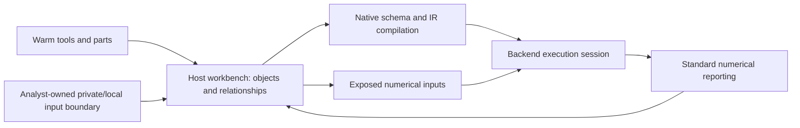

# Pre-D design: host workbench and native execution handoff

**Current status (2026-10-19):** design accepted in #147; bounded D released
in #148 and accepted/merged in #149. #150's combined native activity/focal CPU
review is complete; #152 requests type-phase simplification. GPU/pinning
measurements remain open under #145. The design-time candidate descriptions
below are historical where later implementation evidence supersedes them.
Governing updates:
[#139](https://github.com/Human-Cognome-Project/human-cognome-project/issues/139),
[#145](https://github.com/Human-Cognome-Project/human-cognome-project/issues/145)
and Patrick's recorded 2026-10-16 clarifications. See the separate
[implementation and evidence](../engine/docs/ACTIVE-WORKBENCH.md). This design
record itself changes no runtime, allocator, database or field law.
The allocation/transfer choices below are candidates with explicit experiments;
no measured optimal surface or implemented GPU pinning is claimed.

## 1. Three surfaces and the work they own

| Surface | Responsibility | Lifetime and authority |
|---|---|---|
| Warm toolbox | Reusable shared definitions, parts and reconstructible shared recipes. The cache manager never accesses private/local DB codes or data. | Shared-cache PostgreSQL publication, immutable revisions, epochs and owned pins from A. Generic storage capability does not grant private-data authority. |
| Hot workbench | Assemble selected objects and their relationships on the host; the analyst combines shared tools with its separately supplied personal/local context; retain exact identities, construction/projection paths, membership context, geometry and exposure. Includes assemblies in progress and coherent prepared generations. | Analyst-owned active native state, outside a particular Taichi `Program` and the cache manager's private-data reach. An incomplete assembly cannot become executable. |
| Backend execution memory | Run the prepared objects together using the selected numerical projection, then report results. GPU memory serves this role on a discrete GPU; CPU execution remains supported. | Session-owned allocations and compiled code. Device state is authoritative while a GPU study runs. |

The packed upload buffers are one output of the hot workbench. Pinning concerns
the transferable spans and their lifetime; it does not define the whole hot
cache. CPU-side assembly records, compiler inputs and GPU numerical arrays have
different jobs. Copying the bytes of C++ objects, strings, maps or SNode pointers
is not an execution format.

The arrows describe ownership/data flow, not a new scheduler or transport.
Native test clients supply requests until analyst functions are defined.

## 2. Personal/local information enters the workbench

Private/local data belongs to the analyst. It joins shared cache contributions
only in active hot assembly. The cache manager has no role in reading those DB
codes, preparing private tools, publishing/acquiring private warm recipes or
refreshing private sources. This applies both to the model's own private
information and to private information of entities it interacts with. Public
knowledge about an entity can still belong in the shared cache.

The boundary is access scope before content lookup. Give normal manager
operations only the authorized shared-source directory and credentials; exclude
private/local namespaces and handles from its request and source-resolution
path. Reject an attempted private-scope request at the public request boundary
before any source lookup. Do not open a private source to filter, classify,
redact or decide what may be shared. Do not log private contents or private DB
code values on rejection. This is a required integration gate, not a claim that
Stage A's generic scoped store API already implements that manager-facing gate.

Proposed analyst input boundary: supplied immutable local definitions/context
with `ObjectKey(scope_uuid,address)`, analyst ownership and a local source/version
reference, geometry and explicit relationships. Shared material retains its
existing pinned `ToolRef` / public `BundleRef`; local references retain their
analyst-owned provenance and never masquerade as warm publication references.
Use the same object/occurrence/field identity vocabulary and numerical input
validation for assembly, with tagged source origin. Do not invent a second
address allocator or make a local input pass through `Toolbox::prepare` /
`publish` / `acquire`. Identical addresses in shared and instance scopes remain
different identities. The accepted `y*` / `z*` reservations allocate no internal
production addresses; this clarification does not change all temporary-object
ownership rules.

Source constructions and memberships remain intact. Contextual relationships
added to a working occurrence belong to the instance-owned assembly, rather
than being written onto the shared source definition. For example, a personal
context group may participate with an English occurrence without modifying the
shared English tool's stored `member_of` list. Such an overlay must carry its
source, target, owning instance and occurrence/projection provenance. Importing
it never promotes private-derived definitions into shared warm identity.

Use supplied private-input fixtures to verify this join without implementing
analyst reasoning or accessing real private databases. The analyst is responsible
for obtaining/coherently versioning its local inputs; an arbitrary UUID cannot
stand in for verified source data. The manager neither enumerates those stores
nor chooses relevant private facts. Private data stays at active assembly in this
pipeline, while its analyst-owned source database can remain persistent.
Live-source/WAL adaptation and per-tick database access are outside this work.

Numerical reports return to the analyst-owned workbench with scoped provenance.
Execution/reporting is not permission to send private sources, codes or joint
assembly results into cache-manager reporting, refresh or shared publication.
Compilation consumes schema/IR rather than private source values/codes; keep
private runtime values out of shared compiler-cache keys, names and artifacts.

The shared-tool request is not the joint active-study request. In particular,
private-derived placements, geometry, annotations or local relationships remain
on the analyst side even when all referenced tool addresses happen to be shared.
The analyst sends only the permitted public-tool request to the manager, then
combines its private context after receipt. A shared object key alone cannot
make a private-derived recipe a permissible warm publication. The initial D
warm round-trip uses explicitly shared synthetic inputs; it proves no private
recipe publication path.

Overlay preparation is a proposed workbench seam, not a claim that C already
implements personal-context overlays. C follows the owning letter's actual
pinned membership graph. Broader overlay semantics require review before code.

## 3. Native interface findings

Source inspected at main `6ccd5a3`; C's bounded preparation is reviewed separately
in #146 at `8508ee3`. These findings describe existing code, not proposed speedups.

| Boundary | Verified behavior and implication |
|---|---|
| [Assembly preparation](../engine/src/assembly/study.cpp) | Prepares exact counts, geometry, explicit scale and active occurrences before staging. `FixedStudy` supports equal-count refresh and becomes non-runnable on failed publication. It is not the complete workbench or a general recomposition implementation. |
| [Field harness](../engine/src/field/field.cpp) | Packs scalar SoA host vectors, creates matching Ndarrays, compiles seven field kernels and binds arrays/counts/parameters at launch. Upload is bulk; there is no per-element GPU feeding requirement. |
| [Native compiler wrapper](../engine/src/engine/runtime.cpp) | `CompiledKernel` builds typed IR parameters and calls `Program::compile_kernel`; launch supplies a fresh context to already compiled code. |
| [Compilation manager](../engine/taichi/taichi/compilation_manager/kernel_compilation_manager.cpp) | `load_or_compile` derives a key using config, capabilities and kernel definition and may use cached code. New construction is not evidence of fresh code generation or of zero compilation overhead. |
| [Launch context](../engine/taichi/taichi/program/launch_context_builder.cpp) | `set_arg_ndarray` supplies allocation and runtime shape. `set_arg_external_array_with_shape` supplies a raw pointer, shape and size. Arguments are not a universal serialized Taichi database. |
| [CPU launcher](../engine/taichi/taichi/runtime/cpu/kernel_launcher.cpp) | Uses the raw host pointer for external arrays; unwraps CPU Ndarray allocations for native execution. Direct host binding is a candidate for avoiding payload upload copies. |
| [CUDA launcher](../engine/taichi/taichi/runtime/cuda/kernel_launcher.cpp) | A raw external host array causes temporary device allocation, copy-in and copy-back per launch. Resident device Ndarray arguments avoid that payload path. The launcher still handles argument/result buffers; those costs must also be measured. |
| [Bulk transfer](../engine/src/engine/transfer.cpp) | Passes pointer and byte count to `Device::upload_data` / `readback_data`. No explicit host-pinning or asynchronous completion lease exists in this wrapper. |
| [CPU device](../engine/taichi/taichi/rhi/cpu/cpu_device.cpp) | Current upload/readback use `memcpy`. `map` exposes allocation storage. `import_memory` registers a pointer, but its release path needs ownership verification before using it for an independent HCP allocation. |
| [CUDA device](../engine/taichi/taichi/rhi/cuda/cuda_device.cpp) | Upload/readback use synchronous driver copies. `map` creates a host buffer and copies; host-readable/writable allocation selects managed memory. Neither establishes explicit pinned host staging. |
| [CUDA bindings](../engine/taichi/taichi/rhi/cuda/cuda_driver_functions.inc.h) | Async copies, streams and events exist; explicit host allocation/registration functions are absent from this binding list. Their adapter/ownership work is unbuilt. |
| [Ndarray ownership](../engine/taichi/taichi/program/ndarray.h) | Program-owned allocation and a non-owning view over `DeviceAllocation` are separate constructors. A view does not transfer allocation ownership. Per-element `read` / `write` introduce staging and are unsuitable for bulk assembly. |
| [Program lifetime](../engine/taichi/taichi/program/program.cpp) | Only one live `Program` per process is permitted. Finalize synchronizes and resets the host memory pool; construction resets SNode identifiers. Workbench identity/storage cannot depend on those pool allocations or identifiers surviving restart. |

Current HCP backend selection is x64/CUDA. This is built status, not an
architecture restriction. Vulkan/other backend source facilities do not prove
that the present HCP wrapper can execute that backend.

## 4. Compilation versus values, binding and allocation

Use a versioned native schema description: scalar types, ranks, field-row meanings,
layout/strides, kernel IR, compile configuration and backend capability requirements.
Keep object identity and request data outside the compiler cache key unless the
emitted IR actually specializes on them.

| Change | Required action |
|---|---|
| Position, velocity, radius, positive mass, edge shares/indices, contact values, runtime gravity or timestep; same validated schema/counts | Update the prepared numerical generation or launch parameters. Existing field kernels do not need new mathematical IR. Publish/upload and reseed as required. |
| Another compatible allocation/pointer; same schema and shape | Bind a new launch context after lifetime/size validation. Do not reconstruct a kernel merely because its data pointer changed. This capability is not yet an external-buffer publication API in `field::Harness`. |
| P/G/E/contact counts or compatible Ndarray extents change | Shapes and field loop counts are runtime arguments, but the existing `FixedStudy` rejects count changes. Create a new bounded study/allocations; its constructor currently calls compilation/load paths. Reuse of code across harness instances is a separate measurable optimization. |
| Exposure changes with equal counts | New study UUID and normalized layout under B, with fresh preparation. Matching numerical kernel schema can remain compatible; no old occurrence identity or automatic live-state transfer is promised. |
| Dtype/rank, tensor element layout, row semantics, kernel math or captured constants change | New schema/IR and suitable compilation. CPU thread settings embedded when building field IR also belong to this assessment. |
| A kernel captures a specific SNode tree | New/changed tree requires compatible materialization and kernel binding/compilation. Current field Ndarray kernels do not infer conceptual scale from that tree; preparation supplies converted values. |
| Backend/capabilities or Program generation changes | Recreate executable and allocation bindings for that session. Compatible offline cache may help compilation; old runtime handles remain invalid. |

Native shape compatibility does not authorize arbitrary #123 recomposition.
Likewise, an unchanged buffer count does not establish semantic compatibility
of exposure, relationships or a refreshed assembly.

## 5. Workbench representation and numerical spans

Proposed workbench ownership keeps pure logical recipes, shared tool references,
separate analyst-local references,
occurrence/projection/field maps, exact uint64 counts and supplied geometry outside
the Taichi session. Native SNode pointers and compiled objects belong to the
session and are rebuilt from logical layout records. Draft assemblies can retain
incomplete data; validation prevents unknown mass or missing geometry from
producing an executable generation.

The initial numerical candidate preserves the existing scalar SoA ABI. It is
favored for the first comparison because it feeds the current IR without
changing its math or requiring tensor repacking. This does not establish its
optimality for dense future rollups.
Here SoA means rows of scalar fields. Ndarray's tensor-element AOS/SOA options
are a separate layout concern; the current field arguments are scalar rank-2
arrays, not a serialized object/tensor database.

Let `P` be declared particle slots including inactive alternatives, `G` distinct
fields, `E` participation edges and `K` contact pairs. `n* = max(n,1)`:

| Span | Scalar | Physical shape | Payload bytes |
|---|---|---|---|
| Particles: position, velocity, mass, radius, force | IEEE f32 | `{11,P*}` | `44 P*` |
| Groups: current centroid/mass and accumulation | IEEE f32 | `{8,G*}` | `32 G*` |
| Edge shares | IEEE f32 | `{1,E*}` | `4 E*` |
| Edge particle/group indices | i32 | `{2,E*}` | `8 E*` |
| Contact endpoints | i32 | `{2,K*}` | `8 K*` |
| Determiner output, session-generated | IEEE f32 | `{P*}` | `4 P*` |
| Universal mass scratch, session-generated | IEEE f32 | `{1}` | `4` |

The existing publication uploads the first five spans: total
`4 (11 P* + 8 G* + 3 E* + 2 K*)` bytes. Seeding generates determiner/universal
state. Reporting currently reads particles/groups and, when P > 0, determiner
values. Compiler/runtime metadata, argument buffers and backend scratch are
additional costs, not hidden in this payload estimate.

For each scalar matrix, offset is `sizeof(T) * (field_row * n* + item)`.
The current empty logical arrays use sentinel storage and zero loop counts.
Use checked `size_t` products for bytes; retain native i32 axis/index limits.
The fork's widened flattened LLVM offsets do not prove equivalent limits for
every untested backend. Validate 4-byte scalar representation and span bounds.

A span descriptor carries analyst/workbench ownership, role/schema version,
scalar/rank, dimensions, row
stride, used bytes, reserved capacity, alignment, owning assembly generation
and access/completion lease. Reserved capacity is not an implicit row stride.
Changing counts can change every row offset even if the allocation is reused;
rebuild the generation with its declared layout rather than uploading an old
prefix under a new shape.

Allocate spans with at least scalar alignment and the backend's reported host
registration/allocation alignment. Round and charge reserved bytes explicitly;
do not hard-code a CUDA page size in the common assembly contract. A pointer is
stable for the entire submitted lease; growing/replacing storage creates a new
view. Bound reusable pinned capacity and record the backend's actual pinning
capability/result. Ordinary vector reservation alone is not pinning.

## 6. Candidate allocation and transfer paths

| Candidate | Direct assembly and copies | Ownership / disposition |
|---|---|---|
| Existing vectors → resident Ndarrays | Current baseline. Assembly writes host vectors, CPU upload copies them; discrete GPU receives bulk copies. | Keep as reference/fallback; no pinned guarantee. |
| HCP-owned stable spans → CPU external-array arguments | Assemble directly into checked native views. CPU can execute against host memory without an explicit payload upload. | Preferred CPU experiment. Mutable execution lease excludes concurrent assembly writes. Prove shape/binding and reporting behavior before integration. |
| Program-owned mapped CPU allocations | Assembly can write mapped native allocation storage. | Compare only if useful; pool/session lifetime makes this unsuitable as the sole workbench/recovery owner. Non-owning Ndarray views do not solve that lifetime. |
| HCP-owned spans + backend registration → resident device Ndarrays | Assemble directly into reusable host spans; register eligible spans once per valid backend lease; one bulk publication copy per uploaded span. | Preferred discrete-GPU experiment. Compare registration with backend-owned pinned allocation, including setup/reuse and restart lifetime. No host handles escape the backend adapter. |
| Backend-allocated pinned spans → resident device Ndarrays | Same packed assembly target if allocation/lifetime can be exposed safely; one payload transfer per uploaded span. | Alternative to registration, subject to allocation limits and teardown rules. Retain logical recovery inputs independently. |
| Backend-supported coherent/shared storage | Potential direct access, backend-specific visibility/flush/invalidation rules and performance. | Capability experiment where supported. CUDA managed memory, mapped host kernel access and pinned bulk staging are distinct mechanisms. |

For GPU execution, retain resident device arrays across ticks and bind those
allocations. Passing a host workbench pointer through CUDA's external-host-array
launch path would add temporary payload transfer per kernel and defeats that
candidate. Standard numerical reporting uses bulk readback with explicit
completion; it does not require writing mutated device state to PostgreSQL.

Future assembly code should write its final numerical projection directly into
the selected views, sharing preparation/packing logic with the existing path.
Geometry conversion and projection are real assembly work; eliminating a second
repack does not eliminate those calculations. Simply copying a finished vector
into a pinned buffer adds a host copy and must be measured as such.

Common operations describe capabilities, acquiring stable writable views,
sealing/validating a generation, binding/uploading, completion and reporting.
CUDA registrations, stream/event objects and backend allocation handles stay
behind the engine-support implementation. Unsupported pinning can use a clearly
reported pageable baseline or fail a requested pinned capability; it cannot be
reported as successful pinned operation. LMDB is absent from the default path.

## 7. Publication, execution and result ownership

1. The workbench assembles a draft from shared and selected local inputs while
   any separately owned running generation retains its own resources. This
   does not authorize concurrent mutation of the live study.
2. Capture a coherent generation: source refs/context, exposure, geometry,
   occurrence/field maps and exact contributions. Validate A–C contracts and
   span/index bounds, then seal assembly writes to submitted spans.
3. Prepare session layout/code bindings. On a discrete GPU, submit bulk copies
   into resident arrays; retain source leases until completion. Initial D should
   use the existing synchronous path as its comparison baseline. Async operation
   requires explicit ordering/completion ownership before it can be enabled.
4. Seed all inclusive centroids and initial determiner state from the target.
   Execution-ready follows completed transfer and seeding. Warm tools available,
   a completed workbench assembly and execution-ready are separate conditions;
   a warm DB commit establishes only the warm publication result.
5. During execution, CPU direct-bound numeric spans or GPU arrays have the
   session's exclusive mutation lease. The workbench retains pure logical
   reconstruction inputs and provenance. GPU host staging is an initial/input
   surface until an explicit report updates the corresponding host result view.
6. Result buffers carry session/study/assembly generation and completion. Hold
   destination storage until readback completes; reject stale results before
   exposing them. Do not reuse old result memory while an old transfer could
   still write to it. A report may inform further workbench assembly through
   explicit caller actions; no analyst behavior is inferred.

The current `Harness::download` overwrites its staging/last-downloaded vectors.
A reusable workbench must retain reconstruction inputs separately and distinguish
submitted input from reporting storage. First preserve fail-closed equal-count
publication and complete target validation. Dirty-span reuse, overlapping
transfers and independent double buffers require evidence and explicit leases;
they are not automatic consequences of pinning.

## 8. Restart boundary in a continuously operating system

The workbench/toolbox lifetime belongs to HCP. A `TaichiSession` owns one Program,
SNode materialization, kernels, allocations, registrations and pending operations.
Its session generation invalidates all runtime handles even when numerical slot
values or reset SNode identifiers happen to repeat.

The bounded proposed D restart is a controlled component restart:

1. Stop submissions to that session and make its studies non-runnable.
2. Drain execution/transfers; finish or discard reports by generation. Retain
   all involved views until completion is proven.
3. Destroy FixedStudies/kernels and Ndarray views/allocations while their owner
   is valid, release backend registrations under the adapter's lifetime rules,
   and finalize/destroy the Program. Keep analyst-owned workbench/local inputs
   and shared warm leases outside that scope. Never retain Taichi pool pointers
   across finalize.
4. Create a new session and new study UUID. Rebuild layout, projection, fields
   and initial numerical inputs from an available coherent logical assembly or
   a shared authorized pinned recipe plus separately supplied analyst-local
   inputs. The analyst-owned boundary revalidates or reloads private input;
   the cache manager is never the recovery path for it. Missing local inputs
   leave that joint study incomplete without exposing it to the manager.
   Rebind/recompile as required and seed before
   admitting execution. An old source epoch may require `read_pinned` through
   an existing owned lease or rebuilding current inputs; default acquire must
   not silently bypass A's stale-epoch rules.

This restarts from explicit preparation inputs, not an automatically persisted
live trajectory. An optional last-completed report is not silently promoted to
a restart checkpoint. Preserve exact source identities/contribution records;
new study-local occurrences need not survive a restart.

If completion cannot be established, quarantine the session/resources and refuse
reuse. Recovery from a process-fatal native/driver failure needs a Taichi worker
hosted separately from the continuously operating workbench owner. That hosting
boundary is the proposed fault-isolation direction, rather than pretending a
Program destructor resets the process-wide CUDA context. Current endpoint code
is local/cooperative and provides no process bridge or supervisor. Building
those facilities is a separately reviewed integration task, not hidden D code.
Controlled restart can be tested in the bounded native client; it must not be
reported as proven process-failure isolation. This explicit recovery limit is a
accepted design limit under #145/#147; process-failure isolation remains unbuilt.

## 9. Rollup density and relevant component fields

Patrick's direction is that denser/further algorithmic rollup may expose **more**
relevant component fields through fewer visible particles. Perspective simplifies
the exposed model while retaining underlying relations. Adjacency follows the
study's relationships and scale, not a fixed spatial or storage distance.
Secondary compression remains at 1:1; field degree does not create a distance
factor. A coarser visible object is not assumed to have fewer edges or cheaper
evaluation.

Proposed broader workbench representation: each exposed occurrence has a
projection manifest naming the relevant `FieldKey`s, exact contributions and
ordered source/projection paths crossing the exposed boundary. Hidden source
components remain definitions/provenance; they need not become live particles.
Execution can still use `(particle slot, group slot, share)` edges on the visible
object. Each retained component contribution keeps its own path/count; identical
paths introduced through duplicate traversal can collapse, while different
recorded source positions remain distinct. Source-mass overlap or naming-alias
ambiguity must be resolved by the reviewed manifest, not guessed from depth.

Membership retains one whole-mass edge per target/live occurrence; siblings retain
one per active definition use. Those field kinds remain distinct from component
parent fields. Participation across several different fields is intentional;
their summed field masses are not the construct's physical mass. The existing
universal mass pass counts live particle mass once.

For D's letters, use exactly the accepted B/C projection rather than inventing
new automatic field exposure. The manifest describes the extension boundary for
broader rollups, including explicit local-context overlays; it does not implement
general #123 recomposition or indiscriminately expose every hidden field. Tests
must distinguish preserving relations in the workbench from selecting numerical
terms for this execution.

## 10. Measurements and acceptance

**Executed/source-verified:** native source trace above; `engine_devices
--cpu-only` on 2026-10-16 reports x64, five launch threads, 33.3 GiB host memory
and no CUDA. Existing A/B acceptance and C's 25 pure / 44 native checks establish
their bounded correctness; C's nine hosted checks are green. They do not measure
this proposal's allocation alternatives or production density.

**Unexecuted at design review:** direct CPU external binding integration, host
registration versus allocated pinned buffers, GPU bandwidth/completion, alternative
backend coherence, component-restart fault injection and production-sized density
comparisons. Subsequent bounded D execution is recorded in the separate
[implementation/evidence](../engine/docs/ACTIVE-WORKBENCH.md). No GPU, pinning,
zero-copy or latency improvement is inferred from source alone. No LMDB
benchmark is required.

Use this minimum synthetic matrix, all counts bounded by native limits; fixture
labels allocate no production addresses. Report active count alongside P:

| Case | P | G | E | E/P | Purpose |
|---|---:|---:|---:|---:|---|
| Few visible particles, dense fields | 16 | 4,096 | 65,536 | 4,096 | Rollup with high field exposure |
| Many particles, lower degree | 4,096 | 32 | 8,192 | 2 | Lower field density |
| Matched edge count, different shape | 4,096 | 4,096 | 65,536 | 16 | Separate particle/field/edge costs |
| Skewed versus uniform degree | Hold P/G/E fixed | | | | Expose reduction hot spots and degree-distribution effects |

Vary contact coverage, update frequency and changed-byte volume separately.
Measure native workbench assembly/projection, preparation/conversion, allocation,
registration, payload upload, compilation/cache lookup, first-launch materialization,
steady kernels and reporting as separate phases. Count actual host payload copies,
backend transfers and launcher allocations, plus reserved/pinned/resident memory,
page faults and completion waits. Compare identical schema and input generations,
warm/cold starts and reused/new buffers. Do not select a CPU/GPU crossover from P
alone or hide a host repack in an upload benchmark.

Acceptance separates exact contracts from numerical coherence:

- Exact: scoped identities/revisions, occurrence paths, source ordinals, active
  exclusion, per-edge counts, membership deduplication and initial transfer
  integrity. Check f32/i32 bit patterns at transfer boundaries before execution;
  do not compare results by raw struct bytes or padding.
- Numerical: seeded centroids against an independent inclusive weighted sum;
  first force and whole-mass acceleration against the existing law; finite states,
  contact fixture behavior and inert slots. For small retained fixtures, begin
  with centroid absolute tolerance `1e-5` and first-force absolute tolerance
  `1e-6`; larger/skewed reductions require a recorded scale/degree-aware error
  budget. These are fixture tolerances, not universal model constants.
- Across backend instances/restarts: evaluate the same structural/mathematical
  invariants with explicit absolute/relative tolerances and bounded steps.
  Byte-identical dynamic state or matching trajectories are not required.
- Lifetime: retained host workbench survives controlled session restart, old
  handles/results are rejected, incomplete transfer/seeding never signals ready,
  and no submitted buffer is reused early. Report process-failure isolation only
  when an actual isolated host/worker test is implemented and executed.
- Access scope: instrument public-source resolution/open/query calls. Normal
  manager operations contain no private DB codes; a synthetic private-scope
  request is rejected before lookup with zero source calls for that request.
  No content inspection, private payload/code logging or private connection is
  permitted. This protects model/entity private stores while allowing public
  entity knowledge in the shared path.
- Workbench context: supplied analyst-private fixtures join selected shared
  objects only in active assembly. Preserve scope, local versions, ownership
  and occurrence mapping; verify intended fields, context isolation and no
  manager warm publication/acquisition/refresh or report calls with private
  material. No analyst reasoning or real private DB integration is required.
- Private restart/reporting: retain/reacquire local inputs through their
  analyst owner, rebuild the joint study without manager access, and route
  numerical results only to that active owner. Missing private inputs fail
  readiness rather than falling back to the manager. Original local sources
  remain analyst-owned; no deletion or private hot-state persistence is implied.

Issue #148 explicitly released bounded D under #139 after #147 acceptance.
Its first integration still includes fresh-client warm recipe recovery, native
letter/membership assembly, seeded execution, supported refresh/failure and cold
stores unchanged. Allocation experiments and restart limits must be reported
alongside that result. Neither green C CI nor approval of this document alone
implements the host workbench or its backend adapters.
