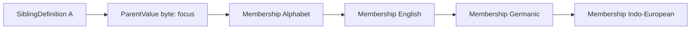

# Retained English pair: comparison, focus and resource decision

**Disposition — 2026-11-18:** [Maintainer comment 6989241451](https://github.com/Human-Cognome-Project/human-cognome-project/pull/375#issuecomment-6989241451) provisionally accepts this bounded decision and authorizes the separate opt-in preset. Its [implementation and actual retained source-to-tick evidence](RETAINED-POSITIVE-CAPTURE.md) at `e86b588e` now pass local CPU checks; authoritative hosted CI/review remain pending. The original proposal/evidence below retain their historical scope. Ten zero responses still leave #324 open.

Status: **proposed qualification profile, with built fixture evidence** under #343. [Maintainer comment 6985194174](https://github.com/Human-Cognome-Project/human-cognome-project/pull/374#issuecomment-6985194174) provisionally accepts #374's corrected refusal route and authorizes this decision. Source `9d9d491fddbf8cb8e75c076d9948f36738ff2fe9` starts from current main `66edfb18`, which integrates #372/#373. Only a test and its registration change. Production profiles, native algorithms, private/shared boundaries and #374's expected refusal remain unchanged. All merges remain maintainer operations.

## Full retained closure

The previous direct-row inspection found English and Alphabet (en). Read-only traversal of the actual 2026-10-13 restored Linguistics data finds **four unique membership targets**, including inherited ancestors:

| Target | Address | Upward relation | Source whole mass |
|---|---|---|---|
| Alphabet (en) | `02.00.00.00.01` | English | NULL |
| English | `02.00.00.00.00` | Germanic | NULL |
| Germanic | `02.00.zz.00.00` | Indo-European | NULL |
| Indo-European | `02.0z.zz.00.00` | None | NULL |

English A `02.00.00.00.03` has direct memberships in **English and Alphabet**. English, Germanic and Indo-European are consequently reachable twice. `MembershipFields::collect` follows pinned upward references and deduplicates each target **per occurrence**. It emits four membership rows for each of the two distinct A occurrences, with count 2 from that occurrence's exact source mass. It does not use a target's unknown naming mass as a denominator. English A still has exact mass 2 and its ordered core-byte parent `00.00.00.00.23` with stored parent-row mass NULL.

The read used the task's existing isolated PostgreSQL 16.15 restore, a SELECT-only role and read-only defaults (`SHOW default_transaction_read_only = on`). Only that fixture cluster was started/stopped. No warm publication, binding-policy change, migration, original-store access or retained-row mutation occurred. Both compressed source hashes were verified again: core `f8019624a617a84410c0fd927b4947ed87955b48280016af8fb40b35eb8ac121`; linguistics `9784ed93d361de61bfb169d13a6e2fd9d2a58eb4dd1ac889b9dc6e0d09e32296`. The retained bundle includes the recursive SQL with explicit C collation, complete path readback and separate JSON records.

Read-only reproduction against the verified Linguistics restore (use a SELECT-only connection with read-only defaults):

```sql
SHOW default_transaction_read_only;
WITH RECURSIVE closure(id,path) AS (
 SELECT ARRAY['02','00','00','00','03']::text[] COLLATE "C", ARRAY[array_to_string(ARRAY['02','00','00','00','03'],'.')]::text[] COLLATE "C"
 UNION ALL
 SELECT m.group_token_id,c.path||array_to_string(m.group_token_id,'.') FROM closure c
 JOIN public.member_of m ON m.token_id=c.id
 WHERE NOT array_to_string(m.group_token_id,'.')=ANY(c.path)
)
SELECT json_build_object('object',array_to_string(c.id,'.'),'path',c.path,'notation',t.notation,'mass',t.mass::text,
 'memberships',(SELECT json_agg(array_to_string(m.group_token_id,'.') ORDER BY m.group_token_id) FROM public.member_of m WHERE m.token_id=c.id),
 'parents',(SELECT json_agg(json_build_object('object',array_to_string(p.parent_token_id,'.'),'ordinal',p.ordinal,'mass',p.mass::text) ORDER BY p.ordinal) FROM public.token_parent p WHERE p.token_id=c.id))
FROM closure c JOIN public.token t ON t.token_id=c.id ORDER BY c.path;
```

## Proposed explicit profile

Add a separate opt-in `prepared-retained-english-pair` after review, retaining `prepared-english-pair` and its verified unsupported-membership refusal. Reuse the current two English aggregate occurrences (entries 10 and 2), source pins, centred radius 0.125, physical mass 1.5 per occurrence, root units 1, pointer-free layout and existing native submission/observer. No starts or source-mass override are supplied.

The proposed comparison order is explicit:

| Index / native field address | Field | Comparison ID | Label / child |
|---:|---|---:|---|
| 0 | SiblingDefinition English A | 100 | 0 / leaf |
| 1 | ParentValue pinned byte parent | 101 | 1 / 0 |
| 2 | Membership Alphabet (en) | 102 | 1 / 1 |
| 3 | Membership English | 103 | 1 / 2 |
| 4 | Membership Germanic | 104 | 1 / 3 |
| 5 | Membership Indo-European | 105 | 1 / 4 |



Arrows denote the chosen **calculation dependency**, with the final node the comparison root. They do not add source parent relations or conceptual LoDs. Keep the existing 0/1 comparison labels and 52 retained fraction bits; the memberships use the private live validator's supported same-level comparisons. All physical objects remain at the one conceptual root with units 1. Dependency depth is six; neither the two distinct labels nor address depth determines that work bound or a scale multiplier.

This preserves the original adjacent SiblingDefinition/ParentValue comparisons and places the membership chain in its actual upward order. It is a caller choice. An alternative equal-cohort ordering also passes the current plan validator: coverage alone cannot select semantic order, and this proposal adds no automatic Analyst policy.

Keep **ParentValue of the pinned byte parent as the sole focus**, exactly as in the current explicit profile. Persist that selection before v2 normalization and provide the same ordered typed focus to admission. The comparison root does not implicitly become focus. An English-membership focus also passes the plan with NULL naming mass because it has a positive selected cohort; it is an available explicit choice, not the recommendation here. Native execution of that alternative focus is not qualified by this witness.

The future producer must validate the complete pinned four-target closure and preserve all direct/inherited references, revisions and NULL masses. Unexpected targets or shape require an explicit new choice. The existing producer already follows the dependencies; no parallel source registry, manager access to private inputs, detached-report admission or new native installer is needed.

## Why the complete equal-cohort tree is unary

The [accepted builder contract](STRUCTURAL-ADMISSION-PLAN.md) and [installed C3 contract](LIVE-HIERARCHY.md) require one comparison owner for every participating field, one rooted tree, and exact per-occurrence parent coverage equal to the sum of child coverage. The two structural fields and four memberships each cover the same two bodies with count/denominator **2/2**.

| Choice | Current supported result |
|---|---|
| Keep only the original comparisons | Refused: all six fields need comparison owners. |
| Independent roots | Refused: installed subset requires one rooted tree. |
| Fork with two full-cohort children | Refused: child coverage overlaps/exceeds the parent's exact per-occurrence count. The witness removes the prior parent first, isolating this coverage failure. |
| Explicit six-node unary chain | Accepted by plan and existing combined native bootstrap. |

With positive identical coverage, every internal node can have only one child in this complete tree. This is a degenerate qualification case. Existing C3 replaces internal direct body forces with child-to-parent influences; a unary parent has no complementary coverage. Each tested first tick records **12 force requests, two leaf evaluations and ten zero responses**. The extra semantic fields therefore do not establish four independent category-force contributions or solve #324's structural/nonstructural distinction. No force, brake, damping, quantization or settling rule changes. Do not generalize this qualification chain to mixed letters/exposures or claim linguistic coherence from it.

All six native cohort centroids have physical mass 3, from two supplied masses of 1.5. That selected-cohort value does **not** fill the four NULL source naming masses or provide their global reciprocals. The source optionals remain absent. Universal physical mass counts the two occurrences once.

## Resource choice

Retain the existing profile's other finite bounds and change only the four limits exposed by the complete closure:

| Budget | Existing / proposed | Evidence |
|---|---:|---|
| Fields | 4 / **6** | Six distinct typed fields, addresses 0–5. |
| CascadeNodes | 4 / **6** | One comparison per field. |
| CascadeLinks | 4 / **5** | Complete unary tree. |
| CascadeLevels | 4 / **6** | Dependency rounds; independent of conceptual scale/labels. |

One-short values independently refuse with the corresponding exhausted budget. The sealed plan contains **20 source commands** (2 bodies + 6 fields + 12 participation rows) and one separate focus reference. Existing BootstrapCommands 32, Participation 16, CascadeReferences/Coverage 32, LiveResponses 64, Particles 4, Potential 128 and the remaining work/cell/reference limits suffice for the fixture. Ordinary Batch stays 1. Body kind/address choices remain 3 and 40/41; fields use kind 5. No streaming expansion or global resource inference is added.

Recompute scratch with the existing f64 calculator and retain the same 256 MiB allowance: **272,358,340 bytes**, versus 272,354,796 before; the calculated reservation difference is **3,544 bytes**. This is sizing evidence, not measured physical memory, RSS or GPU demand. Preserve the existing metadata byte and cumulative allocation-work caps of 16 MiB each, plan/metadata traversal caps 10,000,000 each, placement work 100,000,000/cells 65,536, hierarchy/geometry work 1,000,000 and tick work 1,000,000,000. The fixture records plan work 65,778 and metadata reservation peak 7,503 bytes. Source/request/report/Runtime/compiler storage lies outside that measured reservation; actual retained qualification and complete resource accounting remain separate.

## Executable evidence and next boundary

`retained_membership_decision_test` constructs the complete diamond/ancestor shape with four NULL group masses, repeated occurrences and explicit focus. Group keys/labels reflect the inspected shape; **ToolRefs and byte addresses remain synthetic**. It exercises the existing collector, plan and public `submit_prepared`/native observer. It checks exact participation and per-occurrence deduplication, incompatible topology/omission refusal, alternate focus/order validity and four one-short budgets. Native cases verify actual body/comparison claims and IDs, precision, physical mass/geometry, preserved source NULLs, the chosen focus, root scale, one combined commit/zero standalone installs and a following nonzero-dt tick with current generation/body claims. Each output explicitly says `source=fixture_only,retained_tick=unqualified`.

At clean source `9d9d491f`, quick CI passes three native suites, 632-sample placement arithmetic and placement capacity. Clang 15 passes **6/6 CTests in 227.08 seconds**: all four new modes (1/2 workers × bulk/direct), structural plan and unchanged existing profile controls. GCC 11 passes **3/3 in 96.86 seconds**: 1-worker bulk / 2-worker direct new modes and structural plan. Six native fixture modes report the same claims, full ledger and force/resource observations. Production, fork, database/common code and workflows are byte-identical to main. No full local regression, no-unroll, CUDA or actual retained source-to-tick execution is claimed. GitHub CI is authoritative; #374's final native gate remains separate from its reviewed, inspected refusal evidence.

Verified machine-local bundle: `/tmp/hcp-membership-decision-9d9d491f-evidence.tar.gz`, SHA-256 `3cf19af011ae4874e7ac4da18364a60c94757d7bec19c07600976d0d9a981c42`. Profile and bundle manifests pass. It retains source/cleanliness, exact commands/logs, compiler/runtime/binary hashes, source patch, actual read-only closure, payload hashes and separately unqualified development logs. Corrected development report-accessor/authorization compilation errors and the initial inspection query's collation error are not counted as qualification; no retained record changed. The hash does not publish the raw bundle.

Next: review this explicit profile decision. After acceptance, implement the separate opt-in preset using acquired warm source pins and the existing session/observer, then run it against fresh isolated v2 qualification storage. Retain payload hashes, all acquired pins, both full native claims, six comparison identities/generation, completed tick at least 1 and successful lease release. Preserve the original refusal test, v1 capture, unknown source masses and shared/private boundary. Actual retained C3 completion, broader accounting and #324 remain open.
